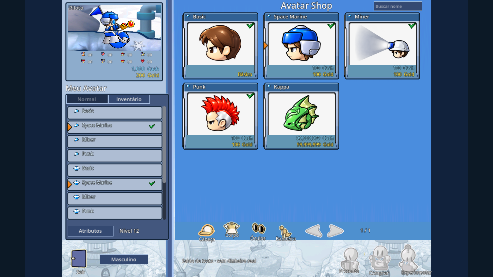
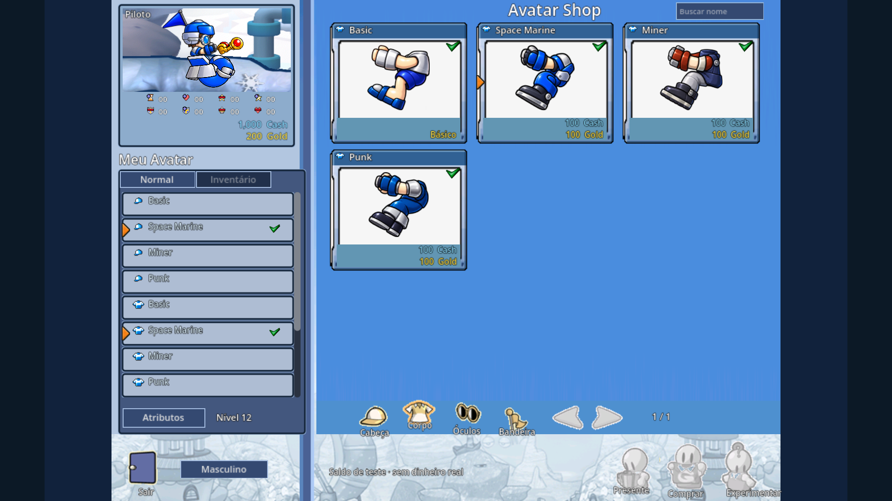
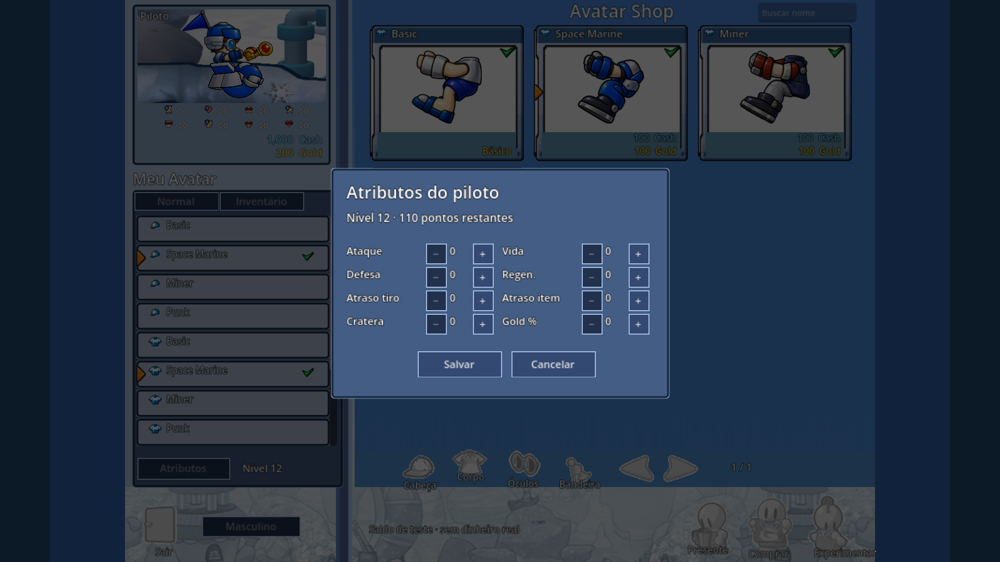
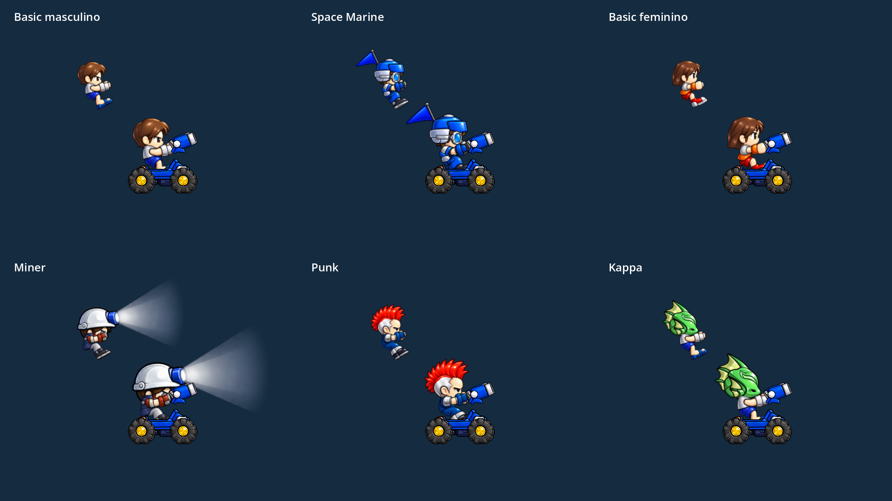
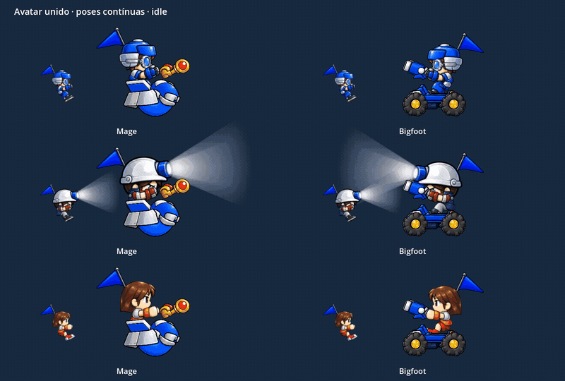

# Gunbound Recomp

Protótipo de artilharia 2D por turnos, em **Godot 4.7.2 + GDScript**. A versão atual é a **0.14.5**: treino offline **1×1 contra o computador no macOS**, no mapa Miramo Town, com Bigfoot e Mage, HUD de batalha, clima, itens e loja de avatar.

O jogo reescreve, em Godot, mecânicas e assets do OpenBound em C# (pasta local `~/Workspaces/Gunbound`), com arte HD própria. **Gunbound** é marca de terceiros. Este repositório é um protótipo local de estudo, sem publicação, notarização ou distribuição.

## Status

| | |
|---|---|
| Versão | **0.14.5** — loja clássica integrada à `main` |
| O que dá para jogar | Menu, loja, uma partida 1×1, pausa, resultado, revanche e perfil local |
| Validação automática | **1758 verificações e 10 partidas completas, zero falhas** |
| Aplicativo | `builds/Gunbound Recomp.app` (Universal, assinatura ad-hoc para teste local) |
| Aceite visual | A suavidade dos avatares (0.14.4) foi confirmada. A composição da loja 0.14.5 ainda aguarda o seu olhar no aplicativo |

O relato passo a passo de cada entrega está em [docs/sdd/HANDOFF.md](docs/sdd/HANDOFF.md). Este arquivo é o mapa do que existe hoje.

## Como está funcionando

### Loja de avatar

No menu, **Shop de avatar** abre a loja no layout clássico: grade 3×3, inventário lateral sempre visível e prévia do piloto no mobile. Cabeça, corpo, óculos e bandeira vêm do catálogo original (15 registros). **Experimentar** mostra uma peça ainda não comprada. **Comprar** gasta Cash ou Gold. Clicar um item possuído no inventário veste e grava. **Presente** permanece desligado: não há amigos nem presentes no treino offline.

O primeiro perfil recebe, uma única vez, 1.000 Cash e 1.000 Gold de teste. Esse saldo não é dinheiro real.





**Atributos** abre um painel separado. Cada avanço de nível local libera 10 pontos, até 180 no total e 50 por atributo. Salvar aplica na próxima partida; cancelar ou Esc descarta o rascunho. Ataque, defesa, vida, regeneração, atraso de tiro, atraso de item, cratera e Gold % entram no combate do jogador e da máquina, com as mesmas regras.



Os conjuntos visíveis em HD são Basic, Space Marine, Miner, Punk e Kappa, nos dois mobiles e nos dois sentidos.



A animação abaixo é a captura atual: o avatar respira junto, acompanha o corpo e troca de pose (repouso, movimento, carga, recuo e dano) sem trocar a anatomia a cada quadro. O vídeo integral está em [docs/avatar-motion/motion.mp4](docs/avatar-motion/motion.mp4).



### Batalha no Miramo Town

A arena é o Miramo Town A em escala nativa, com câmera que segue o mobile, o tiro e o impacto. O terreno HD é visual; a colisão usa o alpha do mapa original. Crateras apagam o chão. Cair da ilha elimina o veículo.


O HUD é o de batalha do OpenBound: armas 1, 2 e SS, ângulo, força, movimento, previsão do clima, ordem dos turnos, bússola, relógio e vida. A carga vai de 0 a 100 em 2 segundos. Itens ocupam a barra F1–F6.


O clima muda em colunas no mapa: Força, Fraqueza, Espelho, Tornado, Elétrico, Aleatório, Proteção e o satélite Thor. O menu escolhe o clima original do mapa ou todos os efeitos. Vento 2D altera a trajetória. O raio do Thor e as partículas de chão estão em [docs/weather/](docs/weather/).


### Tiros

Bigfoot solta bombas em sequência: quatro no tiro 1, duas rajadas de três no tiro 2 e oito no SS. Mage dispara laser, dois lasers em hélice e um orbe que zera escudos próximos. A folha abaixo isola o voo e o impacto de cada arma; o título gravado na imagem ainda é o da entrega 0.6.2.


## O que já foi entregue

| Versão | O que entrou no jogo |
|---|---|
| 0.1–0.2 | Partida 1×1, terreno destrutível, vento, dano, queda, fila por atraso, três dificuldades, pausa, ajuda, resultado, revanche e perfil local |
| 0.3–0.5 | Bigfoot e Mage com sprites, áudio e ataques do pacote original. Bigfoot: salvas T1/T2/SS. Mage: escudo, regeneração, laser, hélice e EMP |
| 0.6–0.6.4 | Arte HD, mobiles articulados, piloto no assento, tiros e impactos contínuos. Roster reduzido a Mage e Bigfoot |
| 0.7 | Nome **Gunbound Recomp**, aplicativo, perfil novo e `scripts/check.sh` |
| 0.8–0.9 | Miramo Town A, câmera rolante, vento 2D, clima, Thor e partículas de chão |
| 0.10–0.12 | HUD original em HD, popup de opções, música, busca da CPU fora do quadro travado, mira Slice e Drag |
| 0.13 | Onze itens de batalha, com custo de atraso, barra F1–F6 e menu Select Item |
| 0.14–0.14.5 | Loja, compra, inventário, oito atributos, Gold da partida, avatares HD, animação contínua, vestir persistido e layout clássico 3×3 |

Números de base, antes dos atributos:

- **Mage:** 760 de vida, 220 de escudo, 90 de movimento, mira 15–50°. Regenera 20 de escudo no próprio turno.
- **Bigfoot:** 1100 de vida, 90 de movimento, mira 18–40° (SS 23–35°).
- O especial destrava no terceiro turno próprio e vale uma vez por partida.
- Vitória 120 XP, derrota 45, empate 70. Um nível a cada 200 XP. Gold da partida é separado do XP.
- A máquina usa a mesma física do disparo real. A dificuldade muda o erro de mira.

## O que ainda falta

### Dentro do protótipo, já conhecido

- A máquina calcula o tiro e permanece parada. Ela também não gasta itens.
- **Mouse Speed** continua desligado. A skin de interface é só a Blue.
- Dos mobiles do pacote original, só Mage e Bigfoot estão no jogo. Resistências e regeneração de vida dos demais seguem de fora. O Mage já regenera escudo.
- Existe um mapa: Miramo Town A. Outros mapas ficaram de fora por decisão explícita.
- A arte de clima e do Thor ainda é a original, em resolução baixa.
- Olhos e gestos dos avatares HD não foram reanimados quadro a quadro.
- A loja lista os 15 registros do catálogo em C#. Chapéus que aparecem só na foto de referência não foram inventados.
- Itens de batalha não se compram com Gold. O ouro da loja é o dos avatares.
- Uma queda depois do teleporte, quando o mobile nasce sob um teto, não causa dano.
- A colisão do terreno é amostrada a cada dois pixels. Pedaços de chão que ficam soltos permanecem no lugar; só os veículos caem.
- O balanceamento é o do protótipo, com atrasos originais divididos por 7,5.
- Builds de Windows, Linux, Android e iOS não foram gerados. A engine permite exportar esses alvos; só o macOS foi validado.
- Vários fluxos — itens, mira Drag, música e a loja 0.14.5 — passaram em teste automático e ainda esperam o roteiro manual em [docs/VALIDACAO.md](docs/VALIDACAO.md).

### Fora desta entrega

Estes itens estão no roadmap e só entram com um pedido novo:

1. Ajuste de desktop depois do feedback: balanceamento, inteligência da máquina, controles e apresentação.
2. Builds Windows e Linux.
3. Multiplayer: autoridade da simulação, sincronização, salas, busca de partida, reconexão e segurança. A tecnologia do servidor ainda não foi escolhida.
4. Ranking, junto com o multiplayer. No treino offline o ranking foi retirado de propósito.
5. Modos 2×2 e outros formatos, depois do multiplayer.
6. Mobile: interface, toque, Android, iOS, cross-play e progresso compartilhado.
7. Contas, campanha, monetização e distribuição pública.

## Como jogar

Abra **`builds/Gunbound Recomp.app`**. Escolha apelido, veículo e dificuldade e inicie o treino. Também dá para importar `project.godot` no Godot 4.7.2 e rodar `scenes/main.tscn`.

| Controle | Ação |
|---|---|
| A/D ou ←/→ | Mover e virar, gastando a barra de movimento |
| W/S ou ↑/↓ | Mirar 1° por toque; segurar acelera a repetição |
| Espaço | Segurar enche a força de 0 a 100 em 2 s; soltar dispara; no 100 dispara sozinho |
| Tab ou 1/2/3 | Trocar tiro 1, tiro 2 e SS |
| F1–F6 ou clique na barra | Usar um item. Um por turno, e o SS fica travado nesse turno. No turno da máquina, o clique agenda o item para o seu próximo turno |
| F8 ou PASS | Passar o turno |
| Esc | Opções: volume, música, rolagem da câmera, fundo e modo de mira |
| P | Pausa: recomeçar, menu, ajuda |
| Modo Drag | Em Opções, Aiming Mode → Drag. Segurar o botão esquerdo e arrastar define a força; soltar dispara. O botão direito olha o mapa |
| F | Virar parado |
| H | Ajuda |

Cada decisão tem 30 segundos. A pausa congela relógio, projéteis e animação, e cancela uma carga sem disparar. Quem acumula menos atraso joga antes.

O perfil fica em `~/Library/Application Support/Godot/app_userdata/Gunbound Recomp/profile.json`. Os testes usam arquivos separados e não alteram esse progresso.

## Executar as verificações

Na raiz do projeto, com o Godot 4.7.2 instalado:

```sh
mkdir -p .tools
/Applications/Godot.app/Contents/MacOS/Godot --headless --editor --path . --import
./scripts/check.sh          # todas as suites, inclusive as dez partidas
./scripts/check.sh --quick  # sem as partidas longas
```

Um checkout novo precisa importar o projeto antes dos testes. `.godot/`, `.tools/` e `builds/` ficam fora do Git.

Para gerar de novo o aplicativo:

```sh
python3 scripts/build_macos.py
```

O template de exportação é o `macos.zip` oficial do Godot 4.7.2, em `.tools/macos.zip`. O script exporta, normaliza o executável para `GunboundRecomp`, assina e gera o ZIP. Rodar o projeto no editor não atualiza o `.app` já exportado.

## Onde aprofundar

| Documento | Para quê |
|---|---|
| [docs/sdd/HANDOFF.md](docs/sdd/HANDOFF.md) | Estado, evidências e como retomar |
| [docs/sdd/SPEC.md](docs/sdd/SPEC.md) | Requisitos REQ-* e critérios |
| [docs/sdd/DESIGN.md](docs/sdd/DESIGN.md) | Arquitetura, turnos e invariantes |
| [docs/sdd/TASKS.md](docs/sdd/TASKS.md) | Entregas e pendências rastreadas |
| [docs/sdd/DECISIONS.md](docs/sdd/DECISIONS.md) | Decisões e o que cada uma substituiu |
| [docs/VALIDACAO.md](docs/VALIDACAO.md) | Roteiro manual no aplicativo |
| [docs/APRENDIZADO.md](docs/APRENDIZADO.md) | Leitura guiada do código |
| [AGENTS.md](AGENTS.md) | Contexto para uma próxima sessão de agente |

Capturas que não entraram acima: [HUD](docs/hud/hud-player-turn.png), [opções](docs/hud/hud-options-popup.png), [Thor](docs/weather/weather-thor-lightning.png), [seleção de itens](docs/items/select-item.png), [crateras](docs/map/miramo-craters.png) e o estudo de animação articulado em [docs/animation/animation.gif](docs/animation/animation.gif).
