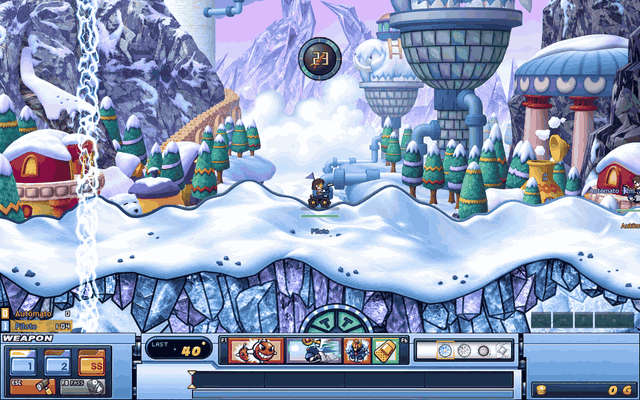
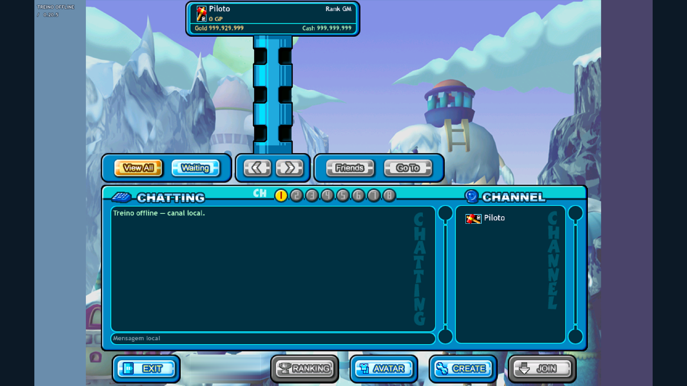
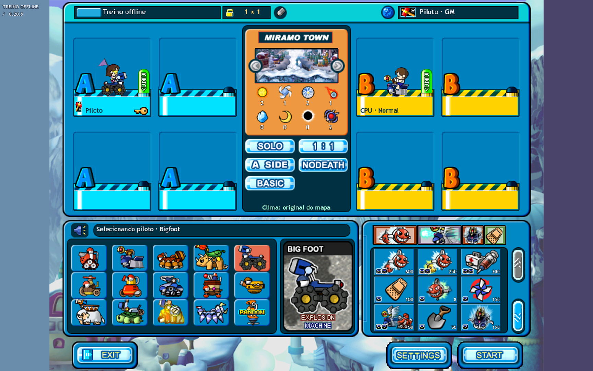
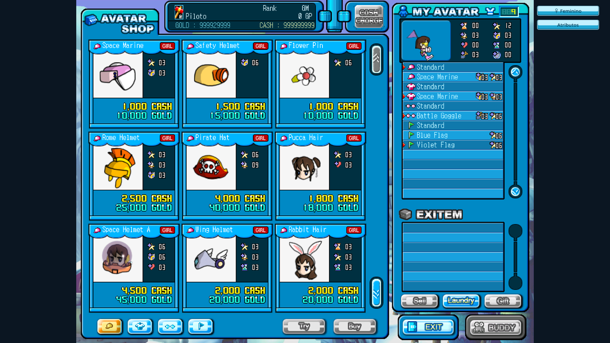

# Gunbound Recomp

A fidelity-focused rewrite in **Godot 4.7.2 + GDScript** of
[jglim/gunbound-launcher](https://github.com/jglim/gunbound-launcher) (the launcher and
TestClient for **GunBound Thor's Hammer**) and
[jglim/gunbound-server](https://github.com/jglim/gunbound-server) (the server emulator).
The goal is to preserve the original game, bring it to multiple platforms, and build new
features on that foundation.

The current implementation covers the client: **offline 1v1 training against the CPU on
macOS**, on Miramo Town A, with all 16 mobiles, items, weather, the classic lobby, room,
and Avatar Shop.

> **GunBound** is a third-party trademark. This is a study prototype with code published on GitHub.
> No application releases have been published in this repository; macOS builds are local and not notarized.
> The port still includes documented adaptations and does not claim full parity with the original client.



| Lobby | 1v1 room | Avatar Shop |
|---|---|---|
|  |  |  |

GPU captures from the current game, 1920×1080 ([how to regenerate](docs/readme/README.md)).

## Vision

1. **Fidelity.** Reproduce the **proven** behavior of the original client and server rather
   than reinventing the game.
2. **Cross-platform support.** Use the same foundation for macOS, Windows, Linux, Android,
   and iOS. Only macOS is currently exported and validated.
3. **Extensions.** Add new features on top of the faithful port, explicitly identified as
   extensions and without altering the original behavior.

Rules, shots, and animations follow this source priority:

1. **Original client** (the binary and XFS/DAT files, analyzed with Ghidra or REA).
   It takes precedence whenever evidence is available.
2. **The jglim projects** (TestClient and server), as references for the rewrite.
   The server alone does not establish how the client renders the game.
3. **Documented adaptations.** When client evidence is incomplete, behavior remains
   explicitly recorded as an adaptation, without a parity claim, until it is ported.

Later versions of the game, such as OpenBound (Season 2), are outside this repository's
scope ([ADR-132](docs/sdd/DECISIONS.md)). Remaining behavior inherited from that phase is
classified as an adaptation to be replaced using client evidence.

Physics, collision, and presentation are separate contracts. Each requires its own evidence:
an independent oracle for numerical behavior, temporal GPU captures for animation,
listening and interaction checks for audio and input, and a verified re-export for packaged
builds. Previously approved visuals are preserved. Modernizing mobile and avatar designs
is a future stage requiring a separate request.

The full methodology is in [docs/PORTE.md](docs/PORTE.md).

## Status

| | |
|---|---|
| Source version | **0.20.5** (single source of truth: `application/config/version` in `project.godot`) |
| Playable flow | Lobby → 1v1 room → 5-second transition showing the map and spawns → match on Miramo Town A → the client's WIN/LOSE window, with OK returning to the room; shop and local profile |
| Validation | Results, dates, and limits for each change are recorded in [HANDOFF](docs/sdd/HANDOFF.md). The full harness includes Godot suites, Python tests, and 29 matches; `--quick` skips the long match suites. Earlier results do not validate later changes |
| Exported application | Local build at `builds/Gunbound Recomp.app`, excluded from Git. The exported 0.20.5 build does not include all subsequent `main` changes; re-export and verify its signature as described in [Development](docs/DESENVOLVIMENTO.md) |

## TODOs

The categories below use these criteria:

- **Delivered:** a stable implementation on `main`, validated by the harness, with no
  implementation work outstanding. Remaining manual validation is tracked in the checklist.
  User acceptance is stated explicitly where recorded.
- **In progress:** implemented with a passing harness, but still awaiting visual acceptance,
  listening or mouse checks, an application re-export, or execution in the original client.
- **Pending:** research or plans only, without an implementation.
- **Roadmap:** outside the current scope; requires a new request.

Per-mobile status is tracked in [docs/MOBILES.md](docs/MOBILES.md). Detailed tasks are in
[docs/sdd/TASKS.md](docs/sdd/TASKS.md).

### Delivered

- 1v1 matches: destructible terrain, wind, damage, falling, delay-based turn order, three
  difficulty levels, pause, results, and a local profile.
- All 16 client mobiles, with fixed IDs and original artwork ([ADR-083](docs/sdd/DECISIONS.md)).
- Shared client ballistics: 20 Hz steps, 24.8 fixed-point arithmetic, a 3-second charge,
  and native minimum power ([BATTLE_FIDELITY_0_20](docs/sdd/BATTLE_FIDELITY_0_20.md)).
- Client turn rules: delay includes time spent aiming, a randomized opening turn, and
  a pass cost of 200 ([BATTLE_RULES_AUDIT](docs/sdd/BATTLE_RULES_AUDIT.md)).
- Miramo Town A at native scale, camera, 2D wind, weather, and Thor.
- Battle HUD and a single classic menu (ESC/Options/P), music, and Slice/Drag aiming.
- Eleven battle items, with the F1–F6 bar and Select Item.
- Turtle T1, T2, and SS with the original wave effect. The user accepted T2.
- Classic lobby and room, including CPU mobile selection. The user accepted the room
  adjustments (ADR-107 through 114).

### In progress

- **Match results** (ADR-139): the WIN/LOSE window from `result_back.img`, with P, G, and
  OK at the client's positions; P displays the port's XP and OK returns to the room.
  The user accepted the captured visuals. [Contract](docs/sdd/RESULT_SCREEN_NATIVE.md).
- **Client battle assets** (ADR-133): Miramo, HUD, weather/Thor, items, and music migrated,
  with tested fallbacks. Header/footer, timer, and wind display were corrected in ADR-134;
  documented gaps, acceptance/listening checks, and re-export remain outstanding.
  [Inventory and validation](docs/sdd/CLIENT_ASSETS_PORT.md).
- **Original Avatar Shop and avatars** (ADR-130/131): visual and mouse acceptance are
  outstanding. The purchase popup remains adapted and the app has not been re-exported.
- **Mage reviewed against the client** (ADR-126/128/129): combat, secondary weather effects,
  and flight particles. Acceptance and listening checks are outstanding. Items, the muzzle
  position, and terrain support remain adaptations bridging the current model.
- **Lightning** (ADR-127) and **Aduka** (ADR-124/125, mounting in ADR-123): visual and audio
  acceptance are outstanding.
- **Raon** (ADR-116 through 120): awaiting acceptance. The exact planting position,
  heading-based rotation, mine contact on slopes, and the buried mine's 30 px search
  remain unresolved.
- **ASate and JD** (ADR-094): GPU capture was blocked before the first frame, and
  acceptance is still outstanding.
- **Bigfoot and Mage with original artwork**, Bigfoot smoothed at 4× (ADR-089/115):
  acceptance and dedicated menu, shop, and arena captures are outstanding.
- **Turtle SS:** damage and physics of the six child projectiles remain adapted.
- **Grub** (ADR-150): four-body T2, bouncing, and repeated SS damage reviewed against
  the client. Tornado, owner attributes, and T1 contact remain adaptations; awaiting
  acceptance. [Record](docs/sdd/GRUB_CLIENT_FIX.md).
- **Boomer** (ADR-142 through 149): shots, damage/craters, muzzle, poses, and wind during
  falling reviewed; slope support has limited visual acceptance. A wind-dependent chassis
  pose while grounded has not been proven. [Evidence and limits](docs/sdd/BOOMER_ISSUE_9.md).

### Pending

- Armor S2 with two impacts, Trico S2, and Dragon S2/SS (volley family).
- Knight satellites and the Ice field.
- A complete review of Bigfoot and Nak. Bigfoot uses inherited attacks; Nak is partially
  ported. Boomer and Grub have recent reviews, with limits and adaptations in the records above.
- Shared damage, collision, terrain support, and wall handling. These remain adapted
  outside the families already reviewed.
- The CPU does not move or use items. Mouse Speed remains disabled.
- Falling after teleporting under a ceiling does not cause damage.
- Manual application checklist: [docs/VALIDACAO.md](docs/VALIDACAO.md).

Porting plans: [BATTLE_MOBILE_FAMILY_PLANS](docs/sdd/BATTLE_MOBILE_FAMILY_PLANS.md).

### Roadmap

1. Desktop adjustments after feedback: balance, CPU behavior, controls, and presentation.
2. Windows and Linux builds. The engine also keeps Android and iOS exports possible.
3. Server rewrite (jglim/gunbound-server) and multiplayer: authority, synchronization,
   rooms, reconnection, and security.
4. Ranking (removed from offline training), 2v2, and other match formats.
5. Mobile: touch interface, Android, iOS, and shared progress.
6. Accounts, campaign, and distribution.
7. Visual modernization of mobiles and avatars.

## Desktop CI and releases

Pull requests run lint, automation tests, the complete game harness and package
smoke checks on macOS and Windows. Successful pushes to `main` calculate a version
from Conventional Commits and publish both ZIPs with manifests and SHA-256 files.
macOS packages are ad-hoc signed, not notarized; Windows packages are unsigned.
Python line coverage and Godot suite results are reported separately.
See [CI/CD implementation and limits](docs/sdd/CI_CD_DESIGN.md) (Portuguese).
Native Windows execution is verified by the hosted pipeline; local validation was on macOS.

## Getting started

Requirements: Git, Godot **4.7.2**, and Python 3 for tooling and validation scripts.
The commands below use the macOS installation at `/Applications/Godot.app`; adjust the
executable path if Godot is installed elsewhere. Windows, Linux, Android, and iOS builds
have not yet been validated.

```bash
git clone https://github.com/guichafy/gunbound-recomp.git
cd gunbound-recomp
```

```bash
/Applications/Godot.app/Contents/MacOS/Godot --headless --editor --path . --import
```

```bash
./scripts/check.sh --quick
```

After cloning, the Godot command imports the project, which is required for a fresh checkout.
`./scripts/check.sh --quick` runs the suites without the long match tests. To play, run
`scenes/main.tscn` in the editor or open the exported app. Controls are documented in
[docs/JOGAR.md](docs/JOGAR.md). Testing and export instructions are in
[docs/DESENVOLVIMENTO.md](docs/DESENVOLVIMENTO.md).

## Documentation

The linked project documents are currently written in Portuguese.

| Document | Purpose |
|---|---|
| [docs/PORTE.md](docs/PORTE.md) | Vision and methodology for faithfully porting the client |
| [docs/MOBILES.md](docs/MOBILES.md) | Status and records for all 16 mobiles |
| [docs/JOGAR.md](docs/JOGAR.md) | Game flow, controls, and profile |
| [docs/DESENVOLVIMENTO.md](docs/DESENVOLVIMENTO.md) | Checks, exports, and code map |
| [docs/HISTORICO.md](docs/HISTORICO.md) | Changes introduced in each version |
| [docs/sdd/HANDOFF.md](docs/sdd/HANDOFF.md) | Current state, evidence, and resuming work |
| [docs/sdd/README.md](docs/sdd/README.md) | SDD documentation structure (SPEC, DESIGN, DECISIONS, TASKS) |
| [AGENTS.md](AGENTS.md) | Context for agent sessions |

## Contributing and reporting issues

Open an [issue](https://github.com/guichafy/gunbound-recomp/issues) with the version or commit,
operating system, reproduction steps, and expected and actual results. For visual differences,
include a capture and state whether the reference is the Thor's Hammer client or a documented
adaptation. Remove personal data and private paths from attachments.

Before proposing a change, read [Porting](docs/PORTE.md) and the requirements in
[SPEC](docs/sdd/SPEC.md). Pull requests should explain the problem, the change, and the
checks performed, including validation limits. Combat changes require the full harness;
navigation and input changes require scene tests. Use isolated profiles for tests.

## References and attribution

The main references are [jglim/gunbound-launcher](https://github.com/jglim/gunbound-launcher)
and [jglim/gunbound-server](https://github.com/jglim/gunbound-server). Asset provenance and
attribution are recorded in the corresponding catalogs and import records. Code, trademarks,
and third-party assets must not be treated as though they share a single license.
