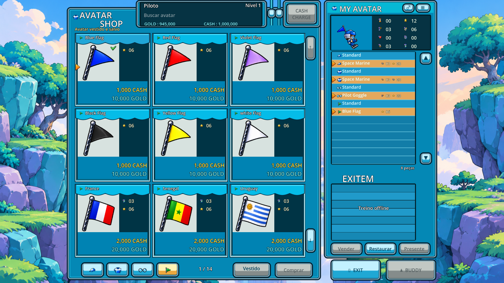
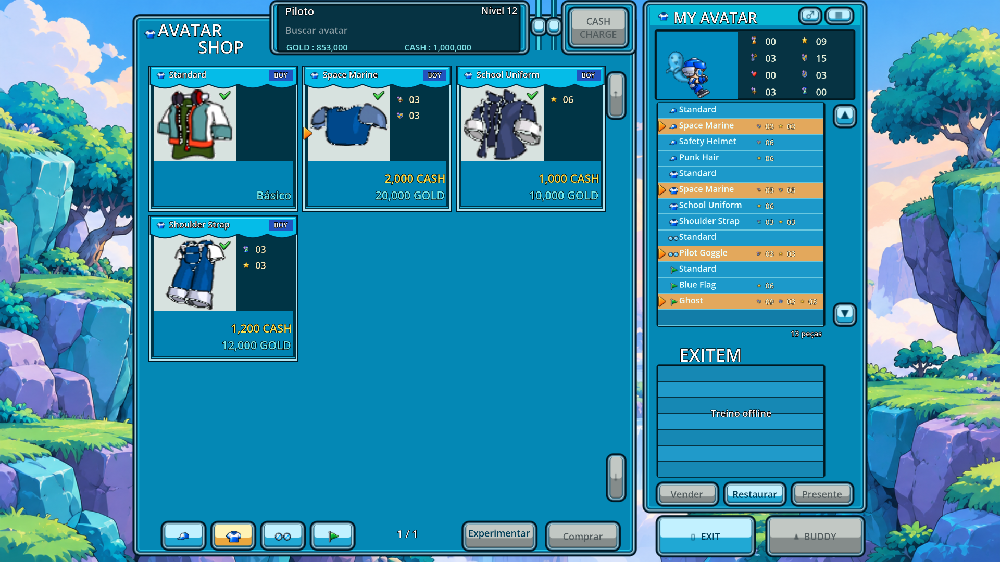
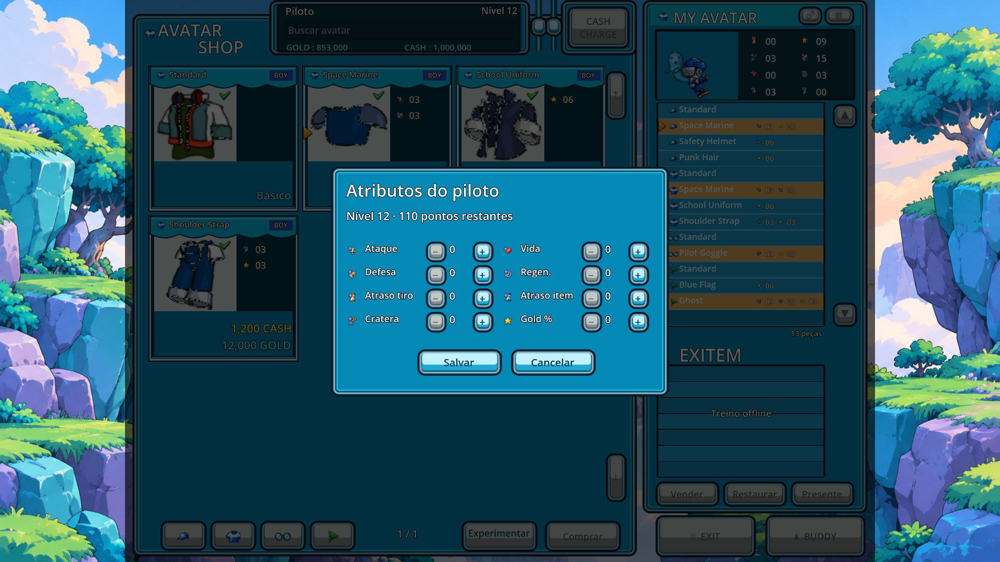
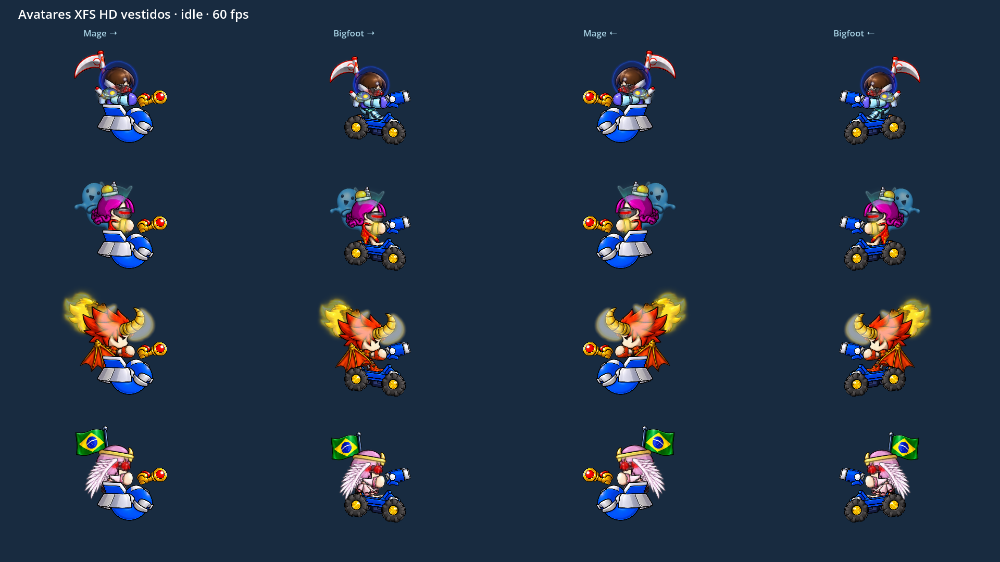
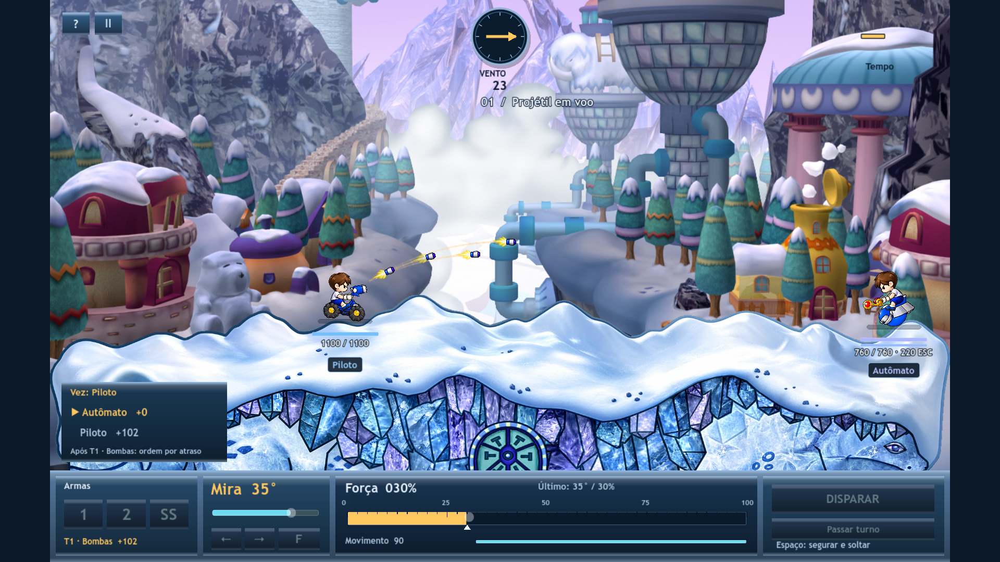
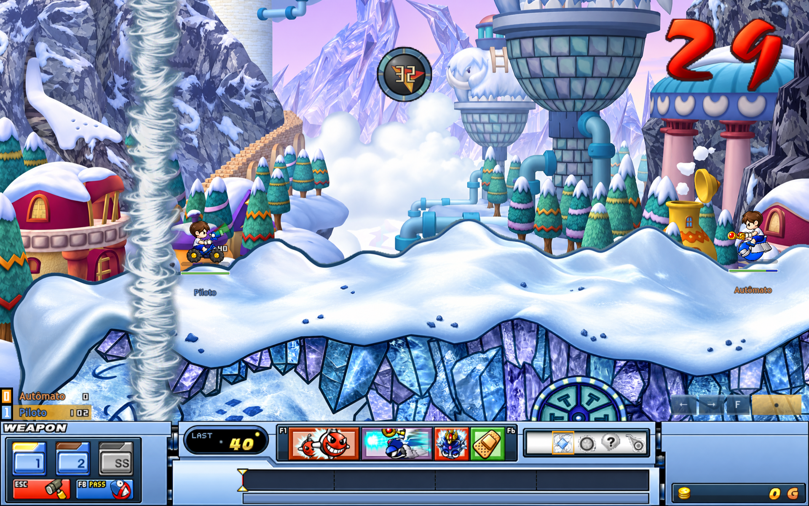
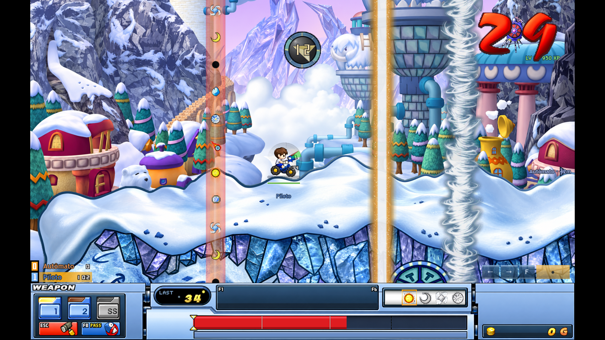
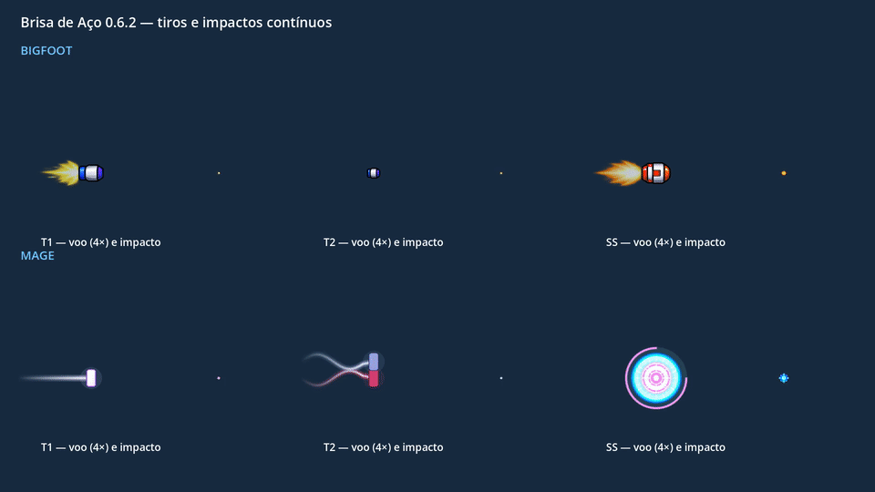

# Gunbound Recomp

Protótipo de artilharia 2D por turnos, em **Godot 4.7.2 + GDScript**. O código atual é a **0.20.2**: treino offline **1×1 contra o computador no macOS**, no mapa Miramo Town, com os 16 mobiles do cliente clássico, HUD de batalha, clima, itens e loja de avatar.

O jogo reescreve, em Godot, mecânicas e assets do OpenBound em C# (pasta local `~/Workspaces/Gunbound`), com arte HD própria. **Gunbound** é marca de terceiros. Este repositório é um protótipo local de estudo, sem publicação, notarização ou distribuição.

## Status

| | |
|---|---|
| Versão do código | **0.20.2** — onda original e rastro do Turtle T2 |
| O que dá para jogar | Menu, loja, uma partida 1×1, pausa, resultado, revanche e perfil local |
| Validação automática | **8020 checks Godot, 16 testes Python e 29 partidas**, zero falhas; [registro 0.20.2](docs/sdd/TURTLE_T2_FIDELITY.md) |
| Aplicativo | App/ZIP **0.20.2** assinados e conferidos; PCK **179 checks/0 falhas**, com ressalva ambiental de CA. [Registro](docs/sdd/TURTLE_T2_FIDELITY.md) |
| Validação visual | T2 normal, força mínima e Tornado: captura temporal 1920×1080/60 FPS inspecionada; escuta, mouse manual e aceite visual pendentes |

O relato passo a passo de cada entrega está em [docs/sdd/HANDOFF.md](docs/sdd/HANDOFF.md). Este arquivo é o mapa do que existe hoje.

## Como está funcionando

### Loja de avatar

No menu, **Shop de avatar** abre a loja ciano do cliente XFS, com grade3×3 à esquerda e inventário à direita. O catálogo contém562registros,479compráveis, com preços e bônus originais. **Experimentar** mantém prévia temporária; **Comprar** gasta Cash ou Gold; clicar uma peça possuída veste e grava. Bônus aparecem nos cards/conjunto e são aplicados na próxima batalha. Ações de rede e venda continuam indisponíveis no treino offline.

O perfil padrão inicia com **999.999.999 Cash e 999.999.999 Gold de teste**. Perfis existentes recebem o novo saldo uma única vez ao abrir a versão 0.18.5, preservando progresso e avatares. Compras posteriores continuam descontando o saldo salvo. Esse saldo não é dinheiro real.





**Atributos** abre um painel separado. Cada avanço de nível local libera 10 pontos, até 180 no total e 50 por atributo. Salvar aplica na próxima partida; cancelar ou Esc descarta o rascunho. Ataque, defesa, vida, regeneração, atraso de tiro, atraso de item, cratera e Gold % entram no combate do jogador e da máquina, com as mesmas regras.



A migração HD está concluída: **550 avatares reais, 629 camadas vestíveis e 550 miniaturas**, com 12 registros N/A explicados. O [controle por avatar](docs/avatar-hd-migration/index.html) mostra fonte, avatar vestido/mobile, efeitos e validação; há também [CSV](docs/avatar-hd-migration/migration.csv). A renderização dos 550 foi auditada sem fallback oculto.



O [vídeo da migração em Full HD a 60 fps](docs/avatar-hd-migration/motion.mp4) mostra repouso, movimento, carga, pausa, recuo e dano. O avatar mantém a anatomia e acompanha o rig; efeitos ficam separados. É uma adaptação HD com peças fixas, sem redesenhar todos os gestos e piscadas originais.

A revisão 0.18 corrige a mistura entre a cabeça de perfil e efeitos frontais. Os 20 modelos de cabeça com luz receberam âncoras próprias no HD. A 0.18.7 refaz o brilho do Great Devil a partir do clássico: a luz é a silhueta do próprio chifre HD, com o núcleo branco e a borda curta do original, mantendo a pulsação. Substitui a meia-lua curvada da 0.18.4 e o halo da 0.18.3. [Comparação a 60 fps](docs/horn-classic/motion.mp4) · [Validação](docs/horn-classic/validation.json).

### Batalha no Miramo Town

A arena é o Miramo Town A em escala nativa, com câmera que segue o mobile, o tiro e o impacto. O terreno HD é visual; a colisão usa o alpha do mapa original. Crateras apagam o chão. Cair da ilha elimina o veículo.



O HUD é o de batalha do OpenBound: armas 1, 2 e SS, ângulo, força, movimento, previsão do clima, ordem dos turnos, bússola, relógio e vida. A carga Slice chega a100% em 3 segundos, com força mínima nativa do mobile. Itens ocupam a barra F1–F6.



O clima muda em colunas no mapa: Força, Fraqueza, Espelho, Tornado, Elétrico, Aleatório, Proteção e o satélite Thor. O menu escolhe o clima original do mapa ou todos os efeitos. Vento 2D altera a trajetória. O raio do Thor e as partículas de chão estão em [docs/weather/](docs/weather/).



### Tiros

A 0.20.2 substitui a órbita aproximada do Turtle T2 pela onda comprovada no
cliente: duas faixas oscilam e depois se aproximam da trajetória central.
[Vídeo Full HD](docs/turtle-t2/turtle-t2.mp4) ·
[Contrato, testes e limites](docs/sdd/TURTLE_T2_FIDELITY.md).


A 0.20.1 corrige os tiros do Turtle: a água permanece contínua nas curvas e o
SS abre antes de se dividir em seis bolhas menores. A captura temporal usa o
modelo e os sprites reais nos dois sentidos, incluindo pausa.
[Vídeo Full HD](docs/turtle-projectiles/turtle-shots.mp4) ·
[Correções, testes e limites](docs/sdd/TURTLE_ANIMATION_FIX.md).


A 0.20 usa o passo balístico original a 20 Hz e ponto fixo 24.8, com força/gravidade por mobile e vento quantizado. Boomer S 2 emite quatro tiros temporizados e seu SS congela durante a transformação. Turtle S 1/S 2 usa a faixa WaterEffect original. As 48 combinações têm cronologia de emissão/áudio documentada; dano, colisão refinada e várias mecânicas especiais continuam adaptações ou portes futuros. [Escopo e evidências](docs/sdd/BATTLE_FIDELITY_0_20.md).

Bigfoot solta bombas em sequência: quatro no tiro 1, duas rajadas de três no tiro 2 e oito no SS. Mage dispara laser, dois lasers em hélice e um orbe que zera escudos próximos. A folha abaixo isola o voo e o impacto de cada arma; o título gravado na imagem ainda é o da entrega 0.6.2.



## O que já foi entregue

| Versão | O que entrou no jogo |
|---|---|
| 0.1–0.2 | Partida 1×1, terreno destrutível, vento, dano, queda, fila por atraso, três dificuldades, pausa, ajuda, resultado, revanche e perfil local |
| 0.3–0.5 | Bigfoot e Mage com sprites, áudio e ataques do pacote original. Bigfoot: salvas T1/T2/SS. Mage: escudo, regeneração, laser, hélice e EMP |
| 0.6–0.6.4 | Arte HD, mobiles articulados, piloto no assento, tiros e impactos contínuos. Roster reduzido a Mage e Bigfoot |
| 0.7 | Nome **Gunbound Recomp**, aplicativo, perfil novo e `scripts/check.sh` |
| 0.8–0.9 | Miramo Town A, câmera rolante, vento 2D, clima, Thor e partículas de chão |
| 0.10–0.12 | HUD original em HD, popup de opções, música, busca da CPU fora do quadro travado, mira Slice e Drag |
| 0.13 | Onze itens de batalha, com custo de atraso, barra F1–F6 e menu Select Item |
| 0.14–0.14.9 | Loja, compra, inventário, oito atributos, Gold da partida, avatares HD, animação contínua, vestir persistido e layout clássico 3×3 |
| 0.15.0 | Loja Full HD/16:9 baseada no vídeo, inventário compacto e prévia Avatar/Mobile |
| 0.16.0 | Design ciano XFS, catálogo 562/479 compráveis, bônus por equipamento e compatibilidade do perfil |
| 0.17.0 | 550 avatares vestidos em HD, 629 camadas, controle individual e animação GPU 60 fps; preserva a integração paralela do Nak original |
| 0.18.0 | Luzes das cabeças no estado Normal, âncoras HD e reparo do Great Devil Head; histórico do PR1 preservado |
| 0.18.1 | Regras de batalha (ADR-076): delay com tempo gasto, abertura sorteada, passe 200, balística do C#, Nak/Mage/itens do cliente original |
| 0.18.2 | Auditoria: CPU paga 2 s fixos e congela o relógio durante a busca, fila do HUD na TurnTable, deriva do vento na queda por passo de gravidade (ADR-077), vento em 0–359 e docs de baseline marcados |
| 0.18.3 | Great Devil Head: aura pulsante derivada do contorno da cabeça HD, pivô compartilhado e ouro preservado; main inclui o merge do PR2 |
| 0.18.4 | Restaura brilho, opacidade e pulsação anteriores do Great Devil; corrige somente a curva por geometria UV constante após rejeição do halo discreto da 0.18.3 |
| 0.20.2 | Turtle T2: agenda nativa de fase/amplitude, largura e orientação próprias; raster de dois triângulos e QA temporal Full HD |
| 0.20.1 | TurtleT1/T2 com água contínua; SS com abertura, seis bolhas próprias e impactos por estágio; captura temporal Full HD |
| 0.20.0 | Minas/fábrica corrigidas, balística comum20Hz/24.8, carga3s/mínimo original, Boomer, WaterEffect e cronologia audiovisual48; pesquisa e planos dos especiais restantes |
| 0.19.0 | Roster dos 16 mobiles do cliente (ADR-083). IDs 1–3 preservados; arte original nos demais |
| 0.18.7 | Brilho do Great Devil Head derivado da silhueta do chifre HD com o perfil do L clássico (ADR-082); substitui a meia-lua curvada da 0.18.4 |
| 0.18.5 | Carteira padrão com 999.999.999 Gold/Cash e concessão única no perfil existente; teste compra e veste todos os 479 avatares compráveis |

Números de base, antes dos atributos:

- **Mage:** 730 de vida, 220 de escudo, 90 de movimento, mira 15–50°. Regenera 30 de escudo no início de cada turno (ADR-076).
- **Bigfoot:** 1100 de vida, 90 de movimento, mira 18–40° (SS 23–35°).
- O especial está liberado no primeiro turno. Depois de usá-lo, volta quatro turnos próprios depois.
- Vitória 120 XP, derrota 45, empate 70. Um nível a cada 200 XP. Gold da partida é separado do XP.
- A máquina usa a mesma física do disparo real. A dificuldade muda o erro de mira.

## O que ainda falta

### Dentro do protótipo, já conhecido

- A máquina calcula o tiro e permanece parada. Ela também não gasta itens.
- **Mouse Speed** continua desligado. A skin de interface é só a Blue.
- Mage e Bigfoot usam arte HD; Nak conserva a arte original. Seus derivados HD estão preservados como fonte pendente de confirmação específica para integração. Os 16 mobiles já são selecionáveis; mecânicas especiais ainda não portadas constam nos [planos por família](docs/sdd/BATTLE_MOBILE_FAMILY_PLANS.md). O Mage já regenera escudo.
- Existe um mapa: Miramo Town A. Outros mapas ficaram de fora por decisão explícita.
- A arte de clima e do Thor ainda é a original, em resolução baixa.
- Olhos e gestos dos avatares HD não foram reanimados quadro a quadro.
- A loja usa o catálogo XFS de 562 registros/479 compráveis; ações de rede continuam indisponíveis.
- Itens de batalha não se compram com Gold. O ouro da loja é o dos avatares.
- Uma queda depois do teleporte, quando o mobile nasce sob um teto, não causa dano.
- A colisão do terreno é amostrada a cada dois pixels. Pedaços de chão que ficam soltos permanecem no lugar; só os veículos caem.
- O balanceamento é o do protótipo, com atrasos originais divididos por 7,5.
- Builds de Windows, Linux, Android e iOS não foram gerados. A engine permite exportar esses alvos; só o macOS foi validado.
- Vários fluxos — itens, mira Drag, música e a loja 0.18.0 — passaram em teste automático e ainda esperam o roteiro manual em [docs/VALIDACAO.md](docs/VALIDACAO.md).

### Fora desta entrega

Estes itens estão no roadmap e só entram com um pedido novo:

1. Ajuste de desktop depois do feedback: balanceamento, inteligência da máquina, controles e apresentação.
2. Builds Windows e Linux.
3. Multiplayer: autoridade da simulação, sincronização, salas, busca de partida, reconexão e segurança. A tecnologia do servidor ainda não foi escolhida.
4. Ranking, junto com o multiplayer. No treino offline o ranking foi retirado de propósito.
5. Modos 2×2 e outros formatos, depois do multiplayer.
6. Mobile: interface, toque, Android, iOS, cross-play e progresso compartilhado.
7. Contas, campanha, monetização e distribuição pública.

## Como jogar

Abra **`builds/Gunbound Recomp.app`** (0.20.0) ou importe `project.godot` no Godot 4.7.2 e rode `scenes/main.tscn`. Escolha apelido, veículo e dificuldade e inicie o treino. [Validação do aplicativo](docs/sdd/BATTLE_FIDELITY_0_20.md).

| Controle | Ação |
|---|---|
| A/D ou ←/→ | Mover e virar, gastando a barra de movimento |
| W/S ou ↑/↓ | Mirar 1° por toque; segurar acelera a repetição |
| Espaço | Segurar chega a 100% em 3 s; soltar dispara; no 100 dispara sozinho; mínimo nativo por mobile |
| Tab ou 1/2/3 | Trocar tiro 1, tiro 2 e SS |
| F1–F6 ou clique na barra | Usar um item. Um por turno, e o SS fica travado nesse turno. No turno da máquina, o clique agenda o item para o seu próximo turno |
| F8 ou PASS | Passar o turno |
| Esc | Opções: volume, música, rolagem da câmera, fundo e modo de mira |
| P | Pausa: recomeçar, menu, ajuda |
| Modo Drag | Em Opções, Aiming Mode → Drag. Segurar o botão esquerdo e arrastar define a força; soltar dispara. O botão direito olha o mapa |
| F | Virar parado |
| H | Ajuda |

Cada decisão tem 30 segundos. A pausa congela relógio, projéteis e animação, e cancela uma carga sem disparar. Quem acumula menos atraso joga antes.

O perfil fica em `~/Library/Application Support/Godot/app_userdata/Gunbound Recomp/profile.json`. Os testes usam arquivos separados e não alteram esse progresso.

## Executar as verificações

Na raiz do projeto, com o Godot 4.7.2 instalado:

```sh
mkdir -p .tools
/Applications/Godot.app/Contents/MacOS/Godot --headless --editor --path . --import
./scripts/check.sh          # todas as suites, inclusive as dez partidas
./scripts/check.sh --quick  # sem as partidas longas
```

Um checkout novo precisa importar o projeto antes dos testes. `.godot/`, `.tools/` e `builds/` ficam fora do Git.

Para gerar de novo o aplicativo:

```sh
python3 scripts/build_macos.py
```

O template de exportação é o `macos.zip` oficial do Godot 4.7.2, em `.tools/macos.zip`. O script exporta, normaliza o executável para `GunboundRecomp`, assina e gera o ZIP. Rodar o projeto no editor não atualiza o `.app` já exportado.

## Onde aprofundar

| Documento | Para quê |
|---|---|
| [docs/sdd/HANDOFF.md](docs/sdd/HANDOFF.md) | Estado, evidências e como retomar |
| [docs/sdd/SPEC.md](docs/sdd/SPEC.md) | Requisitos REQ-* e critérios |
| [docs/sdd/DESIGN.md](docs/sdd/DESIGN.md) | Arquitetura, turnos e invariantes |
| [docs/sdd/TASKS.md](docs/sdd/TASKS.md) | Entregas e pendências rastreadas |
| [docs/sdd/DECISIONS.md](docs/sdd/DECISIONS.md) | Decisões e o que cada uma substituiu |
| [docs/VALIDACAO.md](docs/VALIDACAO.md) | Roteiro manual no aplicativo |
| [docs/APRENDIZADO.md](docs/APRENDIZADO.md) | Leitura guiada do código |
| [AGENTS.md](AGENTS.md) | Contexto para uma próxima sessão de agente |

Capturas que não entraram acima: [HUD](docs/hud/hud-player-turn.png), [opções](docs/hud/hud-options-popup.png), [Thor](docs/weather/weather-thor-lightning.png), [seleção de itens](docs/items/select-item.png), [crateras](docs/map/miramo-craters.png) e o estudo de animação articulado em [docs/animation/animation.gif](docs/animation/animation.gif).
