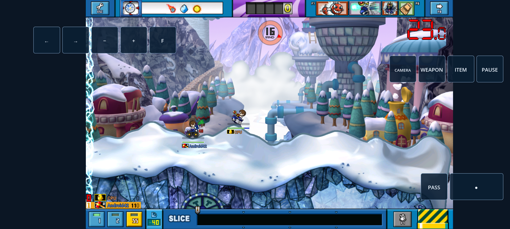
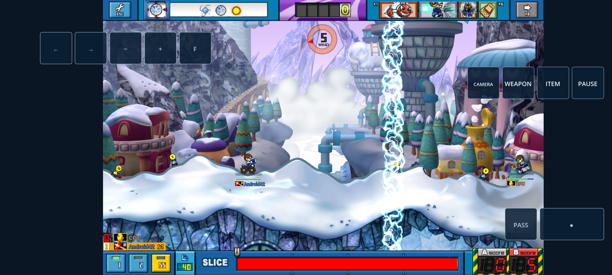

# Android v1 — entrega local e evidência

## Emenda — entrega de teste sem chave de distribuição

O usuário adiou distribuição estável/Play Store. O workflow agora gera o mesmo
candidato com assinatura automática de teste em PR e main padrão, sem secrets.
Somente main com `ANDROID_PUBLICATION_ENABLED=true` exige chave persistente e
segue para os gates oficiais. A exigência pré-merge descrita no fechamento
inicial foi substituída; não é preciso provisionar assinatura para esta fase.
102 testes de automação passaram, incluindo seis combinações de evento/flag e
a execução do shell que escolhe o APK da API24; revisão independente sem P1/P2.
Evidências em [test-delivery-tests.txt](test-delivery-tests.txt) e
[test-delivery-review.md](test-delivery-review.md). Gameplay/exportador/APKs
aceitos não mudaram; o agregado de 103 partidas anterior continua registrado.

## Seguimento de fechamento aceito

Após o teste manual no emulador visível, o usuário confirmou “Agora funcionou”
em15/11/2026 e pediu a branch pronta. `codex/android-v1` usa a main7d1e66d4,
com a correção JEWEL já integrada. Commit/push e issues autorizados; o usuário
abrirá o PR e fará o merge. A primeira revisão de fechamento corrigiu o
observador de logs API24; APIs modernas mantêm o comportamento já testado.
Revisão e regressões em [release-readiness-review.md](release-readiness-review.md)
e [closing-ci-tests.txt](closing-ci-tests.txt). Os APKs abaixo não mudaram.

Pendências de distribuição estão na [issue #56](https://github.com/guichafy/gunbound-recomp/issues/56),
para distribuição estável futura: assinatura persistente ainda não configurada,
modo de distribuição falha sem seus inputs e publicação oficial conjunta fica
desligada sem habilitação/aceite físico. HUD/ergonomia estão na
[issue #55](https://github.com/guichafy/gunbound-recomp/issues/55).
As seções seguintes preservam a evidência da fase local anterior ao fechamento.

15/11/2026. Implementação local sobre `49fdeaa9`, fonte 0.20.5, sem commit,
push, PR, merge, publicação, administração GitHub ou aparelho pessoal.
Design/plano em [SDD](../sdd/ANDROID_V1_DESIGN.md); comandos reproduzíveis no
[guia Android no macOS](../ANDROID.md). O aceite integral Android permanece
aberto pelos gates externos e físicos abaixo.

## Validação final para commit/push

Agregado fresco sobre a main7d1e66d4: **1055,875s, 103 partidas, 140 suítes
Godot, 92.765 checks, 228 testes Python3.13.11, zero falhas, cobertura da
automação56%**. Cem testes CI isolados também passaram em4,028s; Ruff de
correção, actionlint e whitespace aprovados. [Relatório](closing-regression.json),
[log](closing-regression.txt), [Python](closing-python-tests.txt). A correção
API24 está incluída neste agregado. Nenhuma nova validação remota/física é
inferida desses números; o PR será aberto pelo usuário.

## Resultado observado

APKs Android reais foram exportados, inspecionados e executados no macOS
Apple Silicon: AVD `gunbound_android_v1`, API36, ABI executada `arm64-v8a`,
Compatibility/SwiftShader/OpenGL ES3.1, captura 2400×1080. Ambiente em
[environment.json](environment.json); metadados e limites em
[validation.json](validation.json).

| Arquivo local | SHA256 | Execução |
|---|---|---|
| `builds/android/candidate.apk` | `e59c1515892b135c453fa94d73fe846669f40b7e66954d07f63ae21c96b8a2d9` | UI final PASS |
| `builds/android/diagnostic.apk` | `e8425034f0d2ed1151cebb26dd8df4be492fe15bcb3c05d22b5c5aea1444a054` | Diagnóstico PASS |

Ambos contêm arm64-v8a/x86_64, minSDK24/targetSDK36, versão20005,
orientação `userLandscape`, assinatura verificada e alinhamento16k.
Inspeções: [candidato](candidate-inspection.json) e
[diagnóstico](diagnostic-inspection.json). São packages `.ci` com chaves
efêmeras de teste; não são distribuição assinada persistente nem teste de update.

O [relatório UI](ui-report.json) comprova instalação/launch, loja→Voltar→lobby,
Settings/IME, apelido Android42 salvo e visível após relaunch, sala/loading e
SOLO/JEWEL, câmera ON/OFF, pausa por toque/Back, Home, botão Resume explícito,
fechamento da pausa e batalha novamente, force-stop/relaunch com perfil salvo.
Ambos os modos reconheceram o OFF na primeira ação da rodada final.
Após revisão do harness, um [seguimento de câmera](camera-state-report.json)
comprovou no mesmo APK: OFF inicial sem toque e ON→OFF com uma ação;98 testes
CI cobrem também o alvo que desaparece na troca de turno. O seguimento não
repete etapas já verdes de perfil/IME/JEWEL.
Pan e hold de carga foram enviados por adb; deslocamento numérico e disparo
decorrente desses gestos não foram comprovados pelo oráculo visual. Não
confundir esses gestos com partidas naturais concluídas só por toque.
O diagnóstico separado comprova 48 tiros, 66 casos de mapas, JEWEL em22lados,
UI3, zero falhas e perfil isolado: [relatório](diagnostic-report.json).

Logs: [UI](ui-logcat.txt), [diagnóstico](diagnostic-logcat.txt).
Não houve SCRIPT ERROR, crash, ANR ou GL max_texture_size nos critérios dos
smokes finais. O emulador registrou avisos SurfaceSyncGroup/jank e, ao encerrar
o diagnóstico, `eglCodecCommon removeVertexArrayObject ERROR: 7 not found`.
São limites ambientais registrados; não representam escuta ou aceite físico.
Os logcats arquivados normalizam apenas espaços finais; as cópias brutas
continuam em `.tools/android-v1`. O relatório UI lista todos os passos;
esta pasta preserva uma seleção de PNGs.
Os demais frames locais ficam em `.tools/android-v1/local-ui-smoke`.

## Regressões

- Agregado completo antes dos últimos ajustes de plataforma: 1093,258s,
  92.682 checks, 103 partidas, 194 testes Python3.12.14 e cobertura da automação
  51%, zero falhas. [Relatório](full-regression.json), [log](full-regression.txt).
- Faixa final após Back/IME/viewport: 22 suítes, 3.370 checks, 98,146s,
  zero falhas. [Relatório](directed-regression.json), [log](directed-regression.txt).
- Automação final: Python3.13.11, 98 testes CI em5,164s, zero falhas;
  [log](ci-tests.txt). Recortes22 quadros RGBA exatos:2 testes,
  [log](map-crops-tests.txt). Ruff de correção, actionlint com a exceção
  preexistente restrita a `concurrency.queue` e diff whitespace aprovados.
- Revisões independentes de [integração](integration-review.md),
  [layout/IME/recursos](layout-review.md) e [Back](back-review.md), sem P1/P2
  pendente no escopo revisto. Revisor não repetiu a execução dos smokes.

As 103 partidas não foram repetidas por deltas posteriores apenas de
apresentação/input/automação. A faixa dirigida cobre esses deltas; Match,
CPU, terreno e regras de combate não foram alterados. Alterações posteriores
de OCR/espera pertencem ao harness externo, sem alterar os bytes dos APKs acima.

## Correções guiadas pelo runtime

Viewport Android expand permite os alvos dp nas margens; o canvas clássico
continua uniforme. Safe area/IME intersectam display e janela antes da inversa,
evitando subtrair teclado duas vezes. Settings abre IME só após toque.
As prévias usam22 recortes exatos544×336 da tiraHD11968px que excedia o limite
GL; fonte e desktop preservados, fallback nativo explícito.

Back usa Window e quit automático desativado. Os caminhos Activity e raw key
do Godot4.7.2 produziram callbacks separados por160ms; o gate300ms substitui
a proteção por frame. É heurístico: Back intencional dentro300ms é ignorado
e duplicata mais atrasada não tem dedupe garantido. O novo Back aceito cancela
a confirmação de saída existente. A buscaCPU pura é preservada ao suspender,
sem novo sorteio; aplicar resultado exige retomada.

O OCR lê o OK nativo numa região adicional quando necessário e converte a caixa
reconhecida ao quadro completo. A leitura transitória do serviço IME pode ser
repetida dentro do prazo; comandos não são repetidos após falha de transporte.
A câmera é conferida por estado visível, pois a troca de turno também a reseta.
Nenhum alvo ausente/ambíguo vira clique por coordenada presumida.

## Gates restantes

CI Linux PR/fork/main/API24/API36 não executada remotamente; secrets/chave
persistente, environment/reviewers/required checks e publicação não configurados.
Assinatura persistente e atualização entre dois versionCodes conservando perfil
continuam pendentes para distribuição estável. Esse modo falha sem secrets; publicação permanece
desligada sem habilitação e sem atestado vinculado ao APK/run/commit.

Faltam aparelho ARM64 de teste, partidas naturais SOLO/JEWEL completas por toque,
multitouch físico, áudio ouvido, insets/ambas paisagens/IME OEM, desempenho/RAM
e aceite humano do APK exato. AVD ARM64 não substitui esses gates.
O projeto salvo permaneceu intacto: seu diff binário continuou igual ao baseline,
SHA256 registrado em validation.json. Nenhum perfil real desktop foi usado.

## Capturas do APK no AVD

