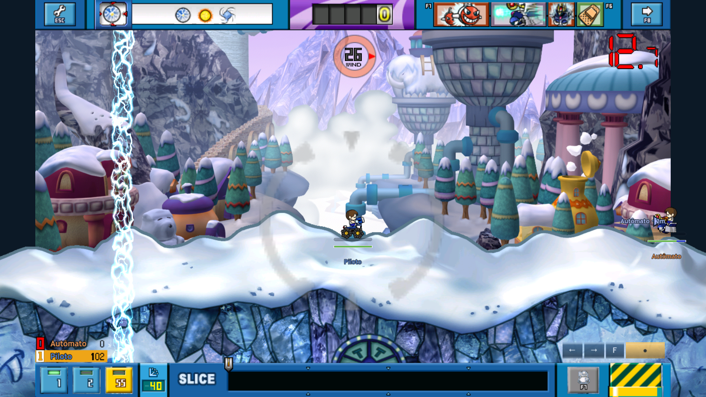

# HUD original em duas faixas

> Correção posterior do fundo: ADR-136, `FOOTER_BACKGROUND_NATIVE.md`
> (em docs/sdd). Capturas anteriores preservam o raster com preto transparente;
> a validação atual está em `docs/footer-background/`.

> A barra MOVE foi corrigida depois destas capturas na ADR-135:
> [posição atual e validação](../move-bar/README.md). As imagens antigas
> `move-*.png` são histórico da posição rejeitada pelo usuário.

Correção da validação visual do usuário. Header: Options/clima/Gold/itens/Skip.
Footer: tiros/ângulo/Slice ou Drag/carga; MOVE aparece durante movimento.

[Movimento corrigido](../move-bar/right-030.png) · [Drag](drag-030.png) · [Eclipse](locked.png) ·
[fallback do clima](weather-fallback.png) · [Opções](options.png).
Referências fornecidas pelo usuário em `reference/`; não são assets runtime.

`tests/capture_battle_hud_layout.gd` produziu360 quadrosGPU1920×1080. Cada caso
Slice/Drag/Move tem120quadros, dos quais30pausados com hashRGBA idêntico;
retomada conferida. Foram salvos21 PNGs, não um vídeo de360frames. Clock60Hz
da simulação não é medição de performance. `capture.json` registra os hashes;
PIL confirmou que30=59 e75difere nos três casos, e todosPNG são1920×1080.

Cronômetro/vento: `tests/capture_hud_clock_wind.gd`,600 quadros adicionais,
quatro cardinais+calmaria,5×30pausados idênticos e retomada.24 PNGs em
`clock-wind/`, incluindo30.0/12.7/9.9/0.0 e fallback integral dos dois grupos.
`direction-proof.json` confere o centroide dos pixels vermelhos do ponteiro
renderizado: produto escalar>0,9999 com cada cardinal esperado.

Fonte/detalhes/testes em [HUD_CLIENT_LAYOUT](../sdd/HUD_CLIENT_LAYOUT.md).
O treinoSolo usaGold; não exibe vidas/pontosJewel. ClienteWindows não
executado, áudio mudo; aceite visual humano pendente. App anterior não foi
reexportado, versão permanece0.20.5. Sem commit/push.
