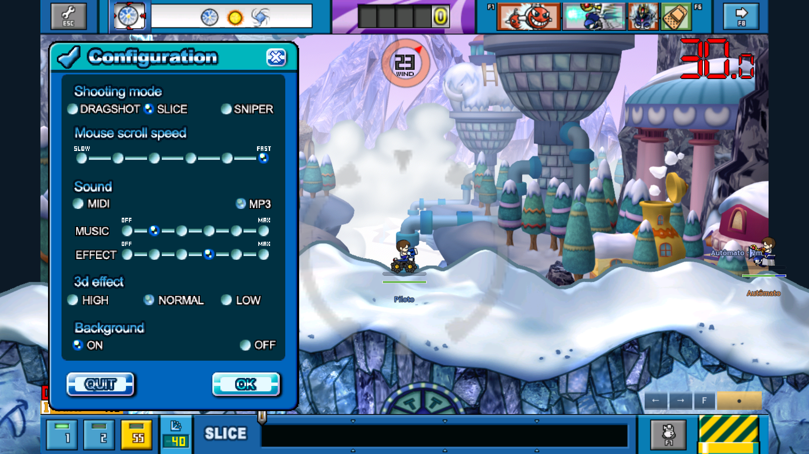

# Menu clássico de batalha

Painel play_option do cliente Thor's Hammer, preservado em276×408 e
posicionado em8,45 no canvas nativo. ESC/Options/P abrem o mesmo menu;
OK confirma, X/ESC cancelam e QUIT volta à sala no treino offline.

Fonte/contrato/limites: [ADR-137](../sdd/BATTLE_OPTIONS_NATIVE.md).
`rea-evidence.json` preserva11registros de análise estática do PE x86,
sem execução do cliente Windows. `asset-inventory.json` registra os originais.
O importador preserva labels/RLE/pivôs e quatro estados dos botões.
Recursos anteriores e HD permanecem em disco, fora do fluxo deste menu.

`tests/capture_battle_options.gd` gera360quadrosGPU1920×1080, três casos
Slice/Drag/voo, pausa30..59 e retomada. `capture.json` e `pixel-proof.json`
conferem dimensões, identidadeRGBA em30/59 e mudança após fechar o menu.
Os24PNGs incluem escolhas via viewport, OK, cancelamento, QUIT e fallback
nativo de grupo inteiro; `native.png` e `fallback.png` são idênticos.
Nenhum perfil real é usado. Áudio mudo; cliques são automatizados no viewport.

O congelamento é adaptação offline. Sniper/MIDI/3d não portados continuam
desabilitados. Seleções e curva de volume vêm do cliente; normalização master
−19dB e resposta da câmera continuam adaptações Godot. Os dois setters nativos
estão em `rea-audio-evidence.json`. Aceite visual e escuta humanos pendentes.

Validação completa final: **110 suítes,28.279 checks Godot,88 testes Python e
29partidas, zero falhas**, exit0. Fontes, recursos e mídias estão em
`verified-source.json`. App/ZIP não reexportados; sem commit/push neste pedido.
