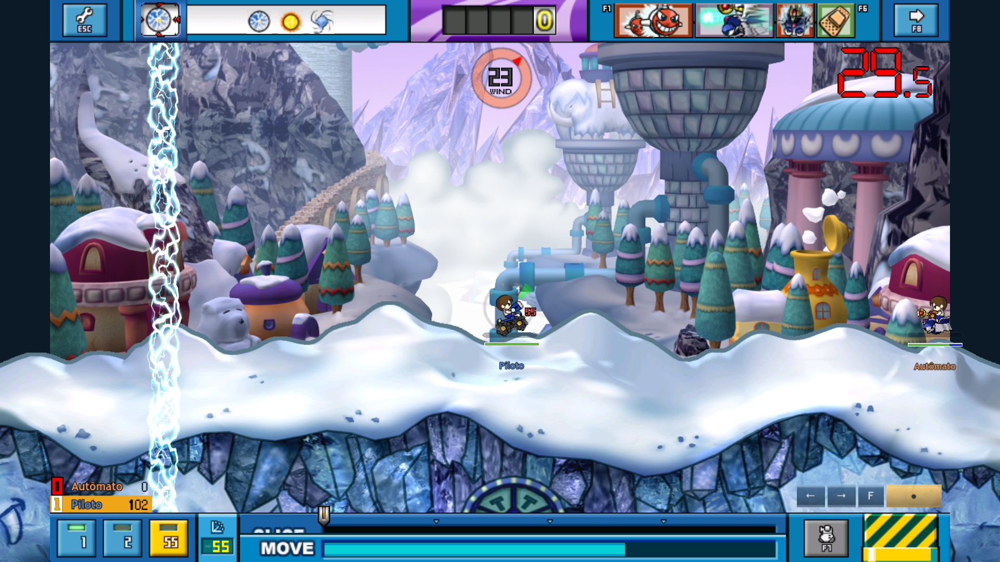

# Fundo original do rodapé

O importador tratava preto RGB565 como transparência. O cliente copia esses
pixels: o fundo agora permanece opaco, inclusive durante MOVE e carga.

[Slice/carga](slice-030.png) · [Drag](drag-030.png) · [Soltura](right-090.png) ·
[Probe magenta](probe-magenta.png) · [Probe verde](probe-green.png) ·
[Fallback](footer-fallback.png).

480 quadros em1920×1080, quatro casos,4×30 quadros de pausa idênticos e
retomada. Probe800×44:35.200 pixels iguais às palavras RGB565 do cliente,
zero transparentes,1.449 pretos restaurados; os dois fundos produzem o mesmo
resultado. [Prova de pixels](pixel-proof.json).

[Contrato, REA e limites](../sdd/FOOTER_BACKGROUND_NATIVE.md). Evidência estática
REA/Hopper, captura Godot M4 Pro e áudio mudo; cliente Windows não executado.
Sem app exportado, versão, commit ou push novos.
