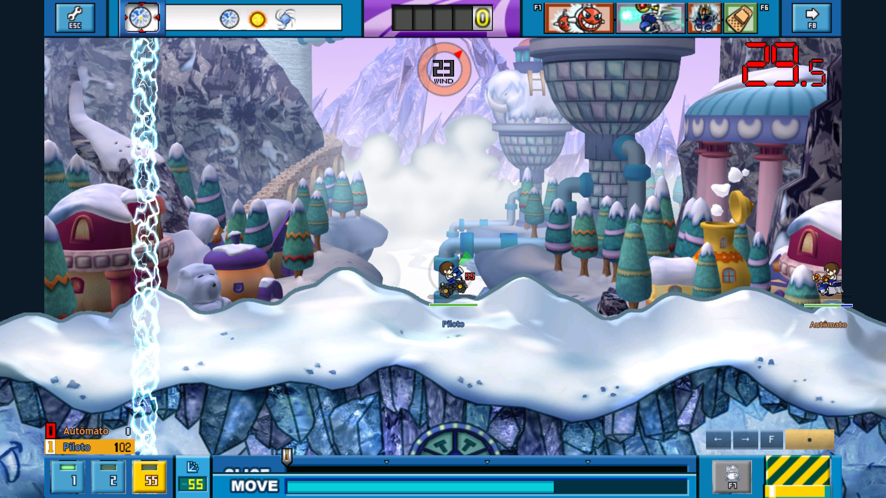

# Barra MOVE na posição do cliente

> Correção posterior do fundo: ADR-136, `FOOTER_BACKGROUND_NATIVE.md`
> (em docs/sdd). Capturas anteriores preservam o raster com preto transparente;
> a validação atual está em `docs/footer-background/`.

A barra aparece na parte inferior do footer, sobre a região de carga. A posição
anterior, acima do painel, foi rejeitada pelo usuário e substituída.

[Abertura compacta](right-000.png) · [Expandida](right-001.png) ·
[Após soltar](right-090.png) · [Esquerda](left-030.png) ·
[Fallback](fallback-invalid.png).

240 quadros temporais em 1920×1080, nos dois sentidos. Cada caso pausa 30 quadros
com RGBA idêntico e retoma; estado compacto/expandido/oculto verificado na
execução. Foram salvos 22 PNGs, incluindo três níveis de preenchimento e duas
falhas simuladas de catálogo/hash; os fallbacks são idênticos à referência
compacta. Valores 0/50/100 são fixtures visuais; não alteram regras do jogo.

Ghidra comprovou consumidor/posição/pivôs/clip/etapas no PE fixado.
[Contrato e fontes](../sdd/MOVE_BAR_NATIVE.md). Captura do Godot M4 Pro, áudio
mudo; cliente Windows não executado. Ritmo da UI continua o do porte.
Sem novo app/versão/commit/push.
